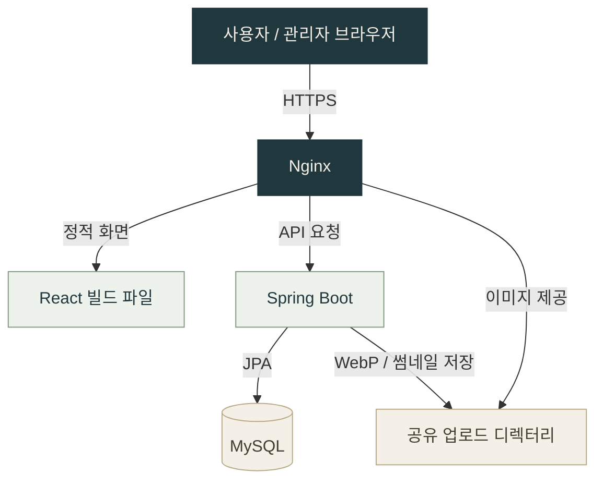

 

`JAVA · SPRING BOOT · REACT`

# JUNHYEOK JEON

### 전준혁 · Web Developer

**화면부터 API, 데이터와 배포까지 연결하는 웹 개발자**

Java와 Spring Boot로 서비스 로직을 구현하고, 
React로 사용자 화면과 운영자를 위한 관리 도구를 만듭니다.

 

  

**BUILD THE EXPERIENCE. CONNECT THE SYSTEM.**

---

## 01 / About

웨딩 스냅 브랜드 **SnapTheTitle**의 홈페이지와 관리자 시스템을 구현했습니다. 
촬영 사진을 탐색하는 공개 화면부터 콘텐츠 관리, 관리자 인증, 이미지 처리, 배포 구성까지 하나의 프로젝트로 연결했습니다.

| 사용자 경험 | 서비스 로직 | 운영 환경 |
| :--- | :--- | :--- |
| 사진 탐색과 확대 보기 | JWT 관리자 인증 | Docker Compose 서비스 구성 |
| 반응형 사용자·관리자 UI | 콘텐츠 CRUD와 데이터 모델 | Nginx HTTPS·API 프록시 |
| 드래그 앤 드롭 사진 정렬 | WebP 변환과 썸네일 생성 | 업로드 파일 제공·정적 캐시 |

 

## 02 / Tech Stack

**프로젝트에서 실제 사용한 기술입니다.**

### Backend

REST API · JJWT · BCrypt · Flyway · Scrimage · Gradle

### Frontend

Context API · Axios · Fetch API · dnd-kit · Recharts

### Infrastructure

HTTPS · Let's Encrypt / Certbot · 정적 파일 캐시 · 공유 업로드 볼륨

 

## 03 / Featured Project

### SnapTheTitle

**웨딩 스냅 홈페이지 & 콘텐츠 관리 시스템**

방문자는 사진과 연도별 상품을 탐색하고, 운영자는 관리자 화면에서 사진과 안내 콘텐츠를 직접 관리합니다. React 프론트엔드와 Spring Boot 백엔드를 **하나의 통합 저장소**에서 관리합니다.

| 구현 영역 | 주요 내용 |
| :--- | :--- |
| **이미지 처리** | 서버에서 WebP 변환과 너비 400px 썸네일 생성, 목록·확대 화면의 이미지 URL 분리 |
| **인증과 권한** | BCrypt 비밀번호 검증, JWT 발급·검증, 관리자 API의 ADMIN 권한 검사 |
| **콘텐츠 관리** | 사진 업로드·노출 순서 변경, 연도별 상품·옵션, FAQ·가이드·제휴 업체 CRUD |
| **방문 통계** | IP 기반 방문 기록, 최근 7일 추이와 유입 경로 차트 |
| **배포 구성** | Docker Compose, Nginx 리버스 프록시, HTTPS와 정적 파일 캐시 |

[**프로젝트 README →**](https://github.com/junhyeok928/snapthetitle-app#readme) &nbsp; · &nbsp; [**서비스 보기 ↗**](https://snapthetitle.com)

<strong>시스템 구조 펼쳐보기</strong>

 

## 04 / Code Highlights

구현 방식은 아래 코드에서 확인할 수 있습니다.

| 관심 영역 | 코드 |
| :--- | :--- |
| 이미지 변환과 첨부파일 저장 | [AttachmentService.java](https://github.com/junhyeok928/snapthetitle-app/blob/main/snapthetitle-backend/src/main/java/com/snapthetitle/backend/service/AttachmentService.java) |
| 서버의 관리자 접근 제어 | [SecurityConfig.java](https://github.com/junhyeok928/snapthetitle-app/blob/main/snapthetitle-backend/src/main/java/com/snapthetitle/backend/config/SecurityConfig.java) |
| React 인증 상태 관리 | [AuthContext.jsx](https://github.com/junhyeok928/snapthetitle-app/blob/main/snapthetitle/src/contexts/AuthContext.jsx) |
| 사진 관리 및 드래그 정렬 | [GalleryManagement.jsx](https://github.com/junhyeok928/snapthetitle-app/blob/main/snapthetitle/src/components/admin/GalleryManagement.jsx) |
| 컨테이너와 서비스 연결 | [docker-compose.yml](https://github.com/junhyeok928/snapthetitle-app/blob/main/docker-compose.yml) |

---

**전준혁 · JUNHYEOK JEON**

[GitHub](https://github.com/junhyeok928) &nbsp; / &nbsp; [Featured Project](https://github.com/junhyeok928/snapthetitle-app)

