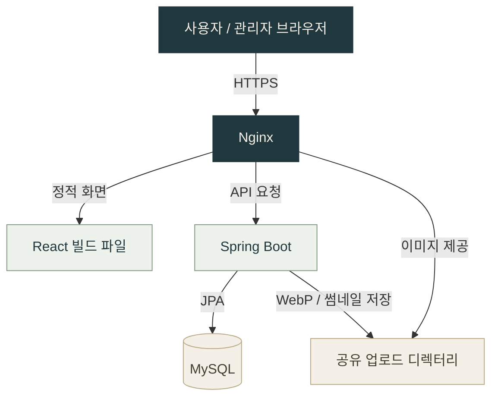

 

`JAVA · SPRING BOOT · REACT`

# JUNHYEOK JEON

### 전준혁 · Web Developer

**화면부터 API, 데이터와 배포까지 연결하는 웹 개발자**

Java와 Spring Boot로 서비스 로직을 구현하고, 
React로 사용자 화면과 운영자를 위한 관리 도구를 만듭니다.

 

  

**BUILD THE EXPERIENCE. CONNECT THE SYSTEM.**

---

## 01 / About

사용자 화면과 서버 로직, 데이터 저장과 배포 환경을 연결하는 웹 개발을 합니다. 
프로젝트별로 해결한 문제와 구현 과정, 사용한 기술을 정리하고 있습니다. 
일상에서 발견한 불편을 요구사항으로 구체화하고, **Codex와 협업해 설계·구현·검증·배포까지 이어가는 AI 활용 경험**도 쌓고 있습니다.

| Frontend | Backend | Infrastructure |
| :--- | :--- | :--- |
| React 기반 화면과 상태 관리 | Java · Spring Boot 기반 API | Docker 기반 서비스 구성 |
| 사용자 흐름과 관리 UI 구현 | 인증·권한과 데이터 모델링 | Nginx 프록시와 정적 파일 제공 |

 

## 02 / Tech Stack

**주요 사용 기술** · 각 프로젝트에 적용한 기술과 구현 내용은 아래 포트폴리오에서 확인할 수 있습니다.

### Backend

REST API · JJWT · BCrypt · Flyway · Scrimage · Gradle

### Frontend

Context API · Axios · Fetch API · dnd-kit · Recharts

### Infrastructure

HTTPS · Let's Encrypt / Certbot · 정적 파일 캐시 · 공유 업로드 볼륨

### Desktop & AI-assisted Development

요구사항 구체화 · UI 시안 비교 · AI와 반복 개발 · 테스트와 오류 수정 · Windows 배포

 

## 03 / Portfolio

프로젝트별 서비스 소개, 개발 범위와 핵심 구현을 모았습니다.

| 프로젝트 | 소개 | 개발 범위 |
| :--- | :--- | :--- |
| [**01 · SnapTheTitle**](#project-snapthetitle) | 웨딩 스냅 홈페이지 & 콘텐츠 관리 시스템 | Frontend · Backend · Infrastructure |
| [**02 · QuadFinder**](#project-quadfinder) | 파일 검색과 다중 패널 탐색을 결합한 Windows 파일 관리자 | Desktop · UI/UX · AI-assisted Development |

 

<!-- PROJECT START: snapthetitle -->

### Project 01 / SnapTheTitle

**웨딩 스냅 홈페이지 & 콘텐츠 관리 시스템**

`React` `Spring Boot` `Spring Security` `JPA` `MySQL` `Docker` `Nginx`

방문자는 사진과 연도별 상품을 탐색하고, 운영자는 관리자 화면에서 사진과 안내 콘텐츠를 직접 관리합니다. React 프론트엔드와 Spring Boot 백엔드를 **하나의 통합 저장소**에서 관리합니다.

| 구현 영역 | 주요 내용 |
| :--- | :--- |
| **이미지 처리** | 서버에서 WebP 변환과 너비 400px 썸네일 생성, 목록·확대 화면의 이미지 URL 분리 |
| **인증과 권한** | BCrypt 비밀번호 검증, JWT 발급·검증, 관리자 API의 ADMIN 권한 검사 |
| **콘텐츠 관리** | 사진 업로드·노출 순서 변경, 연도별 상품·옵션, FAQ·가이드·제휴 업체 CRUD |
| **방문 통계** | IP 기반 방문 기록, 최근 7일 추이와 유입 경로 차트 |
| **배포 구성** | Docker Compose, Nginx 리버스 프록시, HTTPS와 정적 파일 캐시 |

[**프로젝트 README →**](https://github.com/junhyeok928/snapthetitle-app#readme) &nbsp; · &nbsp; [**서비스 보기 ↗**](https://snapthetitle.com)

<strong>시스템 구조 펼쳐보기</strong>

 

<strong>핵심 구현 코드 펼쳐보기</strong>

SnapTheTitle의 구현 방식은 아래 코드에서 확인할 수 있습니다.

| 관심 영역 | 코드 |
| :--- | :--- |
| 이미지 변환과 첨부파일 저장 | [AttachmentService.java](https://github.com/junhyeok928/snapthetitle-app/blob/main/snapthetitle-backend/src/main/java/com/snapthetitle/backend/service/AttachmentService.java) |
| 서버의 관리자 접근 제어 | [SecurityConfig.java](https://github.com/junhyeok928/snapthetitle-app/blob/main/snapthetitle-backend/src/main/java/com/snapthetitle/backend/config/SecurityConfig.java) |
| React 인증 상태 관리 | [AuthContext.jsx](https://github.com/junhyeok928/snapthetitle-app/blob/main/snapthetitle/src/contexts/AuthContext.jsx) |
| 사진 관리 및 드래그 정렬 | [GalleryManagement.jsx](https://github.com/junhyeok928/snapthetitle-app/blob/main/snapthetitle/src/components/admin/GalleryManagement.jsx) |
| 컨테이너와 서비스 연결 | [docker-compose.yml](https://github.com/junhyeok928/snapthetitle-app/blob/main/docker-compose.yml) |

<!-- PROJECT END: snapthetitle -->
 

<!-- PROJECT START: quadfinder -->

### Project 02 / QuadFinder

**매일 쓰던 두 도구의 불편함에서 출발한 Windows 파일 관리자**

`Electron` `JavaScript` `SQLite` `C#` `WPF` `NSIS` `OpenAI Codex`

평소 파일 검색에는 **Everything**, 여러 폴더를 나란히 탐색할 때는 **Q-Dir**을 사용했습니다. 두 프로그램을 오가야 하는 번거로움과 아쉬운 디자인을 개선하고 싶어, 검색과 다중 패널 탐색을 하나의 현대적인 작업 공간으로 묶는 QuadFinder를 **Codex와 협업해 제작**했습니다. Everything을 설치하거나 연동할 필요 없이 자체 로컬 인덱스로 동작합니다.

| 해결한 문제 | 구현 내용 |
| :--- | :--- |
| **검색과 탐색의 분리** | 로컬 파일 이름 검색과 1·2·4분할 탐색, 패널별 독립 탭을 한 화면에 통합 |
| **일상적인 조작의 불편** | 영역 드래그 선택, Windows 우클릭 메뉴, 즐겨찾기·최근 폴더, 마우스 뒤로 가기 |
| **일관되지 않은 화면 구성** | 뉴트럴 블랙·실버 라이트 테마, 공통 팝업 스타일, 패널·탐색 영역 크기와 전체 배율 조절 |
| **인덱싱 지연과 반복 작업** | SQLite 인덱스 저장과 변경 경로 갱신, 네트워크 폴더 제외, 진행 상태·접근 오류 안내 |
| **실행부터 배포까지의 경험** | 첫 실행 사용 안내, 전용 설치 화면, 설치 EXE·포터블 ZIP 공개 베타 배포 |

#### AI를 활용한 개발 방식

**문제를 정의하고 결과를 검토하며, AI와 반복적으로 제품을 완성하는 과정에 집중했습니다.** Codex에 코드를 요청하는 데서 끝내지 않고, 실제 사용 중 발견한 문제를 다음 개선의 기준으로 삼았습니다.

| 내가 주도한 판단 | Codex와 진행한 작업 |
| :--- | :--- |
| **무엇을 해결할지 정의** | 평소 작업 흐름을 바탕으로 검색·분할 탐색·파일 관리 요구사항 구체화 |
| **디자인 선택과 피드백** | 시안을 비교하고 아이콘·글꼴·테마·팝업·설치 화면을 반복 개선 |
| **실제 증상을 바탕으로 우선순위 설정** | 인덱싱 지연, 비활성 창 깜빡임, 탐색 버튼 동작과 CI 실패 원인 점검·수정 |
| **완료 기준 설정** | 단위 테스트 69개, 실제 Electron 통합 검사, 설치·제거와 배포 파일 무결성 확인 후 공개 |

요구사항과 사용성 피드백을 구체적으로 전달하고, 테스트와 배포 결과를 확인하면서 **AI를 개발 전 과정에 활용한 사례**입니다.

[**프로젝트 README →**](https://github.com/junhyeok928/QuadFinder#readme) &nbsp; · &nbsp; [**베타 다운로드 ↗**](https://github.com/junhyeok928/QuadFinder/releases/tag/v0.14.0-beta.1) &nbsp; · &nbsp; [**Windows 검사 ↗**](https://github.com/junhyeok928/QuadFinder/actions/workflows/ci.yml)

<strong>핵심 구현과 검증 코드 펼쳐보기</strong>

| 관심 영역 | 코드 |
| :--- | :--- |
| 로컬 검색 인덱싱과 변경 반영 | [index-engine.cjs](https://github.com/junhyeok928/QuadFinder/blob/main/src/index-engine.cjs) |
| SQLite 인덱스 저장 | [index-store.cjs](https://github.com/junhyeok928/QuadFinder/blob/main/src/index-store.cjs) |
| Windows 셸 연동 | [ShellBridge.cs](https://github.com/junhyeok928/QuadFinder/blob/main/native/ShellBridge.cs) |
| 전용 설치 화면과 동작 | [SetupWindow.cs](https://github.com/junhyeok928/QuadFinder/blob/main/installer/SetupWindow.cs) |
| 실제 앱 통합 검사 | [functional-smoke.cjs](https://github.com/junhyeok928/QuadFinder/blob/main/scripts/functional-smoke.cjs) |

<!-- PROJECT END: quadfinder -->

<!-- 새 프로젝트는 이 위치에 독립된 소개 영역으로 추가하고, 상단 Portfolio 목록에도 링크를 추가합니다. -->

---

**전준혁 · JUNHYEOK JEON**

[GitHub](https://github.com/junhyeok928) &nbsp; / &nbsp; [Portfolio](#portfolio)

